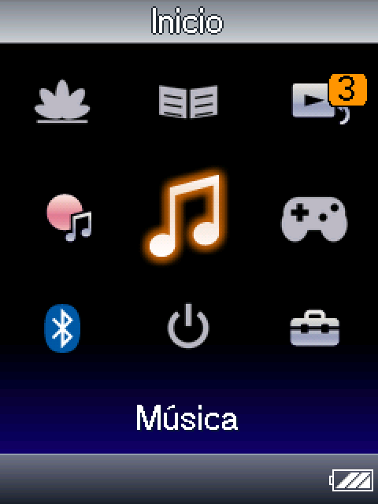
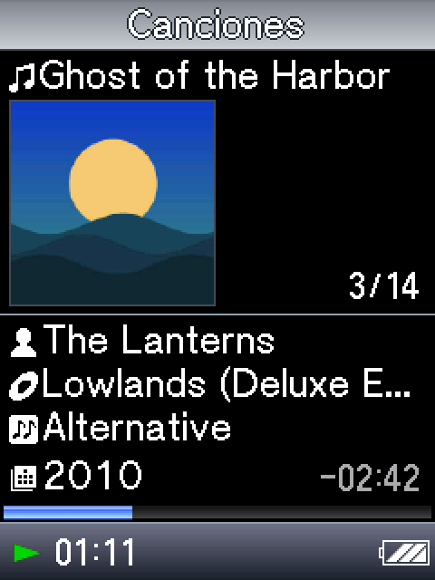
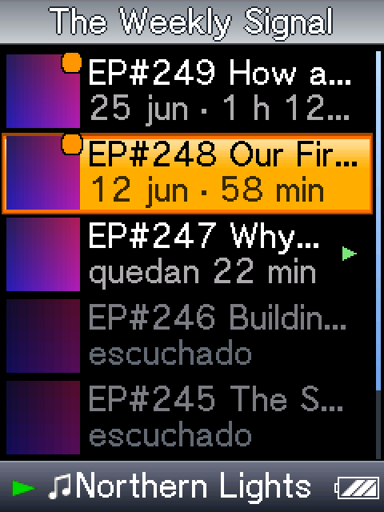
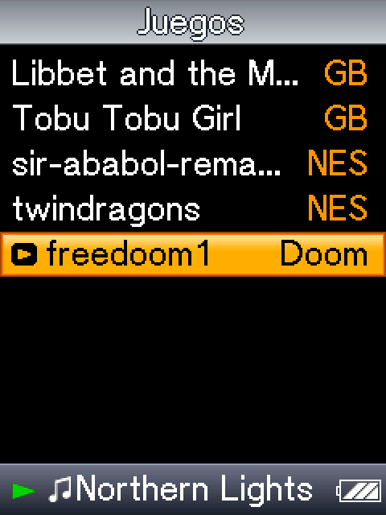

# NW-A820 Homebrew

Custom software for the Sony Walkman **NW-A820 series** (2007, Japanese models; developed on an NW-A829) — a music,
audiobook and podcast player that runs alongside Sony's own UI, plus a few emulators.

<p>




</p>

> **Status: experimental.** Tested on one Japanese NW-A829. The international NWZ-A82x models are untested (see
> [International models](#international-models-nwz-a82x)). Folder names on the drive (`Audiolibros`, `Juegos`) are
> Spanish.

## What it does

- **Drag-and-drop music**: plays MP3, FLAC (up to 24-bit; hi-res is resampled to 44.1 kHz), AAC/M4A and
  non-DRM ATRAC straight from the drive. No SonicStage. Gapless MP3, ReplayGain, cover art, lyrics (`.lrc`), 5-band EQ.
- **Audiobooks and podcasts**: resume per file, playback speed 0.75×–2× with pitch kept, chapters, transcripts,
  sleep timer.
- **Podcasts on the device** over Bluetooth tethering from a phone (BNEP + lwIP + Mbed TLS): search shows by name
  with an on-screen keyboard (Apple Podcasts directory), follow them, browse a feed and download any episode, and
  check for new episodes in the background. Or sync from the PC with `tools/podsync/podsync.py`.
- **Bluetooth audio** (A2DP) to headphones and speakers.
- **Sony's audio DSP**: MP3 decoding and Sony's sound effects on the Walkman's dedicated NEC DSP.
- **Games**: Game Boy / Color (gnuboy), NES (agnes), GBA (gpSP), Doom (doomgeneric).
- **Dual boot**: the Sony UI is untouched. Hold HOME for 3 s in the Sony UI to switch to the player; HOME for 3 s in
  the player (or "Back to the Walkman") goes back. The Walkman remembers which one you used last. If the player ever
  fails to start properly, the next boot goes to the Sony UI by itself.
- **USB like Sony's UI**: plug the Walkman into a computer while the player runs and it shows up as a drive; eject
  it, unplug, and the player starts again where it was.
- **English or Spanish**: chosen on the first start, changeable in Settings > Language. Settings > Reset everything
  clears the player's state (positions, settings, pairings) without touching your files.

## How it works

The Walkman runs Linux 2.6.10 on an ARM926 (MP201 SoC). The official 1.02 firmware is modified in exactly three places
(see [`firmware/build_hb.py`](firmware/build_hb.py)):

1. **A hook in `/etc/init.d/gemini`**: before Sony's UI starts, if `H:\HB\boot.sh` exists, run it. Without that
   file the Walkman boots exactly like stock.
2. **The version string**, which becomes `1.02-41` so you can tell the firmware apart.
3. **A one-instruction patch in Sony's UI** that hides the "Simple Mode" popup at startup (Japanese model only).

Everything else (the player, emulators, Bluetooth, networking) is ordinary programs in `H:\HB\bin`, built with
`zig cc` against the device's glibc. Read [`docs/`](docs/) and [`research/dsp/FINDINGS.md`](research/dsp/FINDINGS.md)
for the reverse-engineering notes.

**No Sony files are in this repository.** The firmware tools start from the official updater, which you download from
Sony, and patch it on your own computer.

## Installing

> ⚠️ This flashes a modified firmware. It has worked repeatedly on the developer's unit and Sony's official firmware
> can be put back at any time, but you do this at your own risk. Charge the battery first and don't unplug the
> Walkman while it updates.

1. Download **`Walkman-Homebrew-Installer.exe`** from the [latest release](https://github.com/manuaguirre9/nw-a820-homebrew/releases).
2. Open it. Windows will probably show a blue **"Windows protected your PC"** box, because the program isn't signed
   with a paid certificate: click **More info**, then **Run anyway**.
3. Connect the Walkman with its USB cable, in Sony's normal mode. The window finds it by itself and shows the model
   and firmware.
4. Tick the battery box and press the button. If your Walkman has an older firmware than Sony's last one (1.02), the
   button first says **Step 1: update to 1.02**; after that it says **Install**. About two minutes each.
5. When it says *Done*, unplug the Walkman. Hold **HOME for 3 seconds** to open the player (it asks for the
   language the first time); HOME for 3 seconds again goes back to Sony's Walkman.

The installer downloads Sony's official updater from Sony, takes the firmware out of it and patches it on your
computer; every step is checked against known MD5s (the patched firmware is byte-for-byte the one tested on the
developer's unit), so a changed or damaged download stops it before anything is flashed. It also builds the patched
Bluetooth helper from that firmware and fetches `cacert.pem` for HTTPS. Run it again later to update the homebrew
or to uninstall it.

**En español:** descargá `Walkman-Homebrew-Installer.exe`, abrilo (si Windows muestra "Windows protegió su PC":
*Más información* → *Ejecutar de todos modos*), conectá el Walkman y seguí lo que dice la ventana. El instalador está
en español si tu Windows lo está.

<details><summary>From the command line (developers)</summary>

Windows, Python 3 with `cryptography`, after `sh build_all.sh`:

```bat
python firmware\install.py --check      :: finds the Walkman, downloads Sony's updater, builds and checks everything
python firmware\install.py --firmware   :: an older firmware: Sony's official 1.02 first
python firmware\install.py              :: copies H:\HB, flashes the hook firmware if needed (about a minute)
python firmware\build_installer.py      :: builds dist\Walkman-Homebrew-Installer.exe (pip install pyinstaller)
```

By hand: `firmware/upgpack.py` unpacks the official `NW_WM_FW.UPG`, `firmware/build_hb.py` builds the hook firmware,
`firmware/fwtrig.py go <md5>` makes the Walkman flash `H:\NW_WM_FW.UPG`, and `build/HB` is copied to `H:\HB`.
</details>

### Uninstalling

- **Quick**: delete or rename `H:\HB\boot.sh`. The Walkman boots stock.
- **Complete**: open the installer and press **Uninstall…** (or `python firmware\install.py --uninstall`). It flashes
  Sony's official firmware back; then delete `H:\HB`.

### Where things go on the Walkman

| Folder | Content |
|---|---|
| `H:\Music` | Music (any folder structure) |
| `H:\Audiolibros` | Audiobooks, one folder per book |
| `H:\Podcasts` | Podcasts, one folder per show; `feeds.txt` lists the shows you follow (managed from the device's Podcasts menu, or by hand: [example](tools/podsync/feeds.example.txt)) |
| `H:\Juegos` | Game Boy games; `Juegos\GBA`, `Juegos\NES`, `Juegos\Doom` (`.wad`) for the others |
| `H:\HB` | The homebrew itself; `cacert.pem` here enables certificate checks for HTTPS |

> Without `H:\HB\cacert.pem`, podcast downloads use HTTPS **without** verifying certificates.

## Building

You need [Zig 0.15.2](https://ziglang.org/download/) (set `ZIG` to its path if it isn't on `PATH`), a POSIX shell
(Git Bash works) and Python 3.

```sh
ZIG=/path/to/zig sh build_all.sh     # builds everything and stages build/HB, ready to copy to H:\HB
```

Each program also has its own `build*.sh` next to its sources. The smaller programs under `homebrew/` (`hello`,
`keytest`, `keymap`, `lcdtest`, `meter`, `mp3play`, `hid`, `net/pantest`) are the experiments that led to the
player; they are kept for reference.

The binaries target `arm-linux-gnueabi` (ARM926EJ-S, glibc 2.4 symbols) and are post-processed by
`homebrew/hello/fixpthread.py` because the device has LinuxThreads in libc.

## Testing

```sh
ZIG=/path/to/zig python homebrew/tests/run_tests.py [path/to/gemini/res]
```

On the PC, no Walkman needed: unit tests of the player's logic (podcast directory parser, file names, battery curve,
keyboard layout, translations), every screen rendered in Spanish and in English with a check that nothing is left in
Spanish, a check that every interface text in the code has an English entry, and the device build. The screen renders
need Sony's resources (`/usr/local/share/gemini/res` from the firmware); without them that part is skipped.

On the Walkman (connected as `H:`):

```sh
sh homebrew/hbplayer/build_test.sh          # hbtest: the player plus scripted keys and screenshots
python homebrew/tests/device/stage.py H:     # stages a one-time test run for the next boot
# eject, restart the Walkman, wait ~6 minutes, connect it again
python homebrew/tests/device/check.py H:     # checks the logs, turns the screenshots into PNGs
```

The device run plays an AAC then an MP3 (the DSP's direct mode must survive the change), goes through a first start
in English with an empty state, and searches a podcast over the phone's Bluetooth tethering on a copy of your state.
Nothing it does touches your positions or settings.

## International models (NWZ-A82x)

The international NWZ-A826/A828/A829 use the same hardware and almost the same firmware (same kernel, near-identical
root filesystem; the differences are the UI binary, USB mode (MTP) and the key the update package is encrypted with).
The hook should apply unchanged, but:

- the build script still needs an international variant (different updater and key, no Simple Mode patch);
- `fwtrig.py` needs the Walkman to show up as a USB drive, which may not happen in MTP mode;
- nobody has tried it on a real NWZ unit yet.

If you have one and want to help: open the installer with the Walkman connected, press **Save report** (it only reads
information and changes nothing) and attach the `Walkman-report.txt` it leaves on your Desktop to a new issue.

## Repository layout

| Path | Content |
|---|---|
| `firmware/` | UPG pack/unpack, hook firmware builder, SCSI update trigger and read-only probes |
| `homebrew/` | Player (`hbplayer`), boot scripts, emulator frontends, Bluetooth/network stack, small experiments |
| `homebrew/third_party/` | Upstream libraries (see [THIRD_PARTY.md](THIRD_PARTY.md)) |
| `research/` | DSP and UI reverse-engineering notes and tools |
| `tools/podsync/` | Podcast sync from the PC |
| `docs/` | Firmware notes (Spanish) and the project log |

## License

GPL-2.0-or-later (see [LICENSE](LICENSE)); third-party code keeps its own licence ([THIRD_PARTY.md](THIRD_PARTY.md)).
The `hbplayer` binary also contains sonic (Apache-2.0), so a built `hbplayer` as a whole is distributed under
GPL-3.0; gnuboy, gpSP and Doom are GPL-2.0.
Sony, Walkman, ATRAC and SonicStage are trademarks of Sony. This project is not affiliated with Sony.
